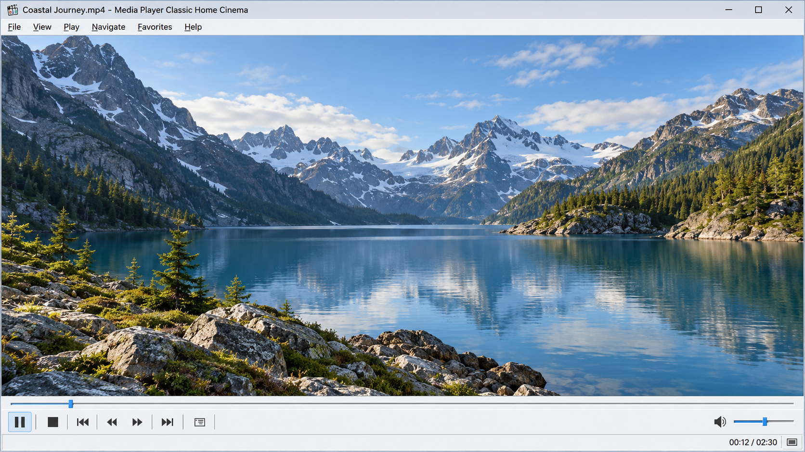
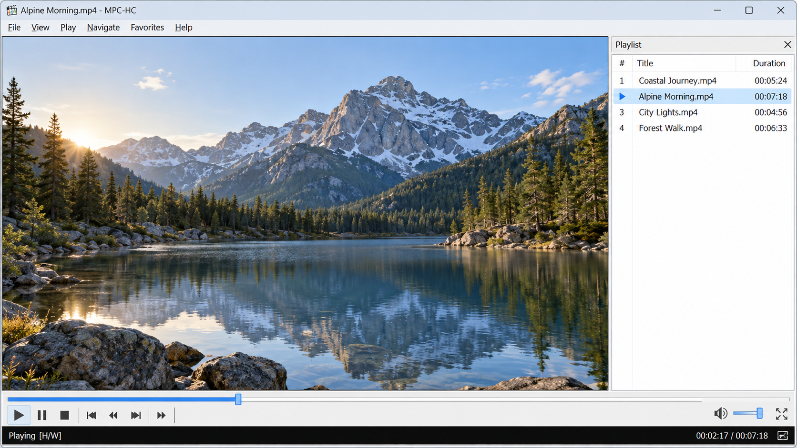
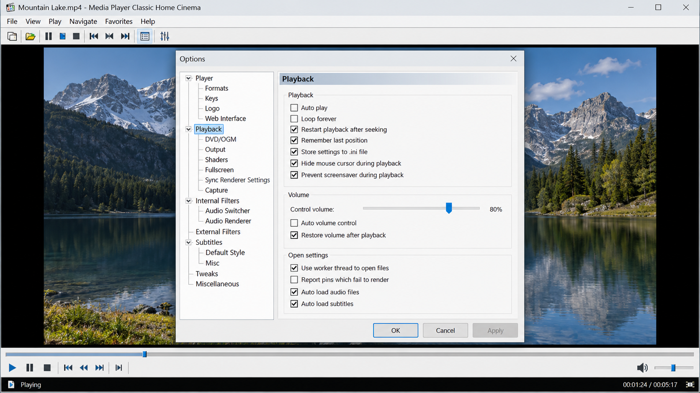

# MPC HC - Lightweight Windows Media Player

Media Player Classic MPC HC maintains MPC HC, a lightweight, open-source video and audio player for Windows. The MPC HC player combines a familiar interface, integrated codecs, DirectShow extensibility, configurable controls, subtitle support, and efficient playback.

## Development Status

Media Player Classic MPC HC is mature, stable, and actively maintained. The community MPC HC fork continues the original project with bug fixes, updated components, security improvements, and support for newer formats.

MPC HC 1.7.13 belongs to the older development line. Users looking for the MPC HC latest version should use a current release rather than an outdated MPC HC EXE.

Internal MPC HC codecs are based primarily on LAV Filters and FFmpeg components. Updating these dependencies keeps MPC HC AV1, MPC HC HEVC playback, MPC HC H264 playback, subtitle parsing, and container support current.

Development focuses on reliability and maintainability. Proposed changes should include a clear purpose, follow the existing C++ style, and avoid unnecessary dependencies.

## Overview of features

Media Player Classic MPC HC provides local audio and video playback through a compact Windows interface. The MPC HC media player supports modern formats, customizable controls, playlists, subtitles, hardware decoding, shaders, web access, and playback history.

### Player Vocabulary

mpc hc, mpc hc player, mpc hc media player, media player classic mpc hc, media player classic home cinema mpc hc, media-player, video-player, audio-player, windows, directshow, hardware-acceleration, subtitle-support, open-source

### What is a media player in a computer?

A media player is software that opens, decodes, renders, and controls audio or video content. Media Player Classic MPC HC performs those tasks with integrated decoding components and Windows playback interfaces. It handles media files, audio tracks, subtitles, playlists, playback positions, renderer selection, and output controls from one desktop program.

### Graphical User Interface

The MPC HC Windows interface supports modern dark and light themes. Users can adjust toolbar button size, seekbar height, status information, fullscreen behavior, and other interface details.

The main window is implemented around [MainFrm.cpp](src/MainFrm.cpp), while reusable controls are organized in [MainFrmControls.cpp](src/MainFrmControls.cpp). Toolbar behavior is represented by [PlayerToolBar.cpp](src/PlayerToolBar.cpp), and timeline interaction is handled by [PlayerSeekBar.cpp](src/PlayerSeekBar.cpp).

### High quality video output

MPC HC HDR playback works with a compatible renderer, GPU, display, and media source. MPC Video Renderer or madVR can provide HDR output, color management, scaling, frame timing, and other advanced rendering features.

MPC HC Dolby Vision results depend on the decoder, renderer, profile, and display chain. Dolby Vision playback should therefore be evaluated with the actual file and hardware instead of being assumed from the container extension.

The repository includes configurable pixel shaders for sharpening, denoising, debanding, color adjustment, scaling, and tone mapping:

- [Debanding.hlsl](shaders/Debanding.hlsl) reduces visible color banding.
- [Denoise.hlsl](shaders/Denoise.hlsl) provides image-noise processing.
- [hdr_tone_mapping.hlsl](shaders/hdr_tone_mapping.hlsl) supports HDR tone-mapping work.
- [LumaSharpen.hlsl](shaders/LumaSharpen.hlsl) and [Sharpen.hlsl](shaders/Sharpen.hlsl) provide sharpening options.
- [resizer_bicubic08.hlsl](shaders/resizer_bicubic08.hlsl) provides bicubic resizing.

### GPU video decoding

MPC HC hardware acceleration can reduce CPU usage during high-resolution playback. MPC HC GPU acceleration includes DXVA2, D3D11 decoding, and Intel QuickSync paths where supported by the selected decoder and hardware.

MPC HC DXVA2 remains useful on compatible Windows systems. MPC HC D3D11 decoding provides a modern hardware-decoding path, while MPC HC Intel QuickSync uses supported Intel graphics hardware. GPU information and capability handling are represented by [GPUInfo.cpp](src/GPUInfo.cpp).

### Features that MPC HC provides

- Modern dark and light themes with an MPC HC custom toolbar.
- Seekbar previews and configurable playback controls.
- MPC HC 4K video player workflows with compatible hardware and renderers.
- Playback of H.264, HEVC, VVC, AV1, AC-4, and many established media formats.
- Improved subtitle rendering with libass and WebVTT support.
- Manual and automatic subtitle search.
- MPC HC subtitle delay and MPC HC subtitle settings controls.
- Adjustable playback speed with compatible audio-renderer pitch correction.
- Playback-position history for resuming files.
- Quick seeking with the mouse wheel.
- Automatic actions after playback.
- A-B repeat for looping a selected segment.
- MPC HC rotate video, flip, mirror, stretch, zoom, and Pan-and-Scan controls.
- Customizable MPC HC keyboard shortcuts and mouse actions.
- Optional online media handling through an external URL extractor.
- Audio-track switching through [AudioSwitcher.cpp](src/AudioSwitcher.cpp).
- On-screen information through [OSD.cpp](src/OSD.cpp).
- Playlist controls through [PlayerPlaylistBar.cpp](src/PlayerPlaylistBar.cpp).
- Subtitle timing controls through [PlayerSubresyncBar.cpp](src/PlayerSubresyncBar.cpp).

### What does an MPC player do?

The MPC HC player opens media, selects the appropriate splitter and decoder, sends audio and video to configured renderers, and provides playback controls. It can switch tracks, render subtitles, remember positions, manage playlists, apply shaders, and expose detailed media information. Media Player Classic MPC HC also supports DirectShow filters, allowing advanced users to customize parts of the playback chain.

### Which player is better than VLC for PC?

The better choice depends on the required workflow. Media Player Classic MPC HC is especially suitable for Windows users who prefer a lightweight interface, DirectShow integration, detailed renderer selection, customizable shortcuts, and low overhead. VLC may suit users who prioritize a broader cross-platform environment, while MPC HC Windows 10 and MPC HC Windows 11 installations provide a focused native Windows experience.

## Screenshots

Media Player Classic MPC HC keeps playback controls accessible without covering the content with a large interface. Theme, fullscreen, status-bar, seekbar, and shader controls can be adjusted independently.

## System Requirements

Media Player Classic MPC HC supports:

- Windows 7, 8, 8.1, 10, and 11.
- An x86 or x64 processor suitable for the selected media format.
- A compatible graphics adapter for MPC HC hardware acceleration.
- Current graphics drivers for reliable MPC HC HDR and 4K playback.

Both MPC HC 32 bit and MPC HC 64 bit configurations are represented by the Visual Studio project. MPC HC x64 is the typical choice for modern 64-bit Windows systems, while MPC HC portable packaging can be used when supplied by an official release.

## Downloads

### How do I get Windows Media Player on my desktop?

Windows Media Player is a separate Windows component, but Media Player Classic MPC HC can be placed on the desktop through its own installation workflow. Run the MPC HC installer, create or retain the desktop shortcut, and select MPC HC as the default application for desired media formats if needed. An MPC HC portable build can instead be extracted and launched directly, with a shortcut created for its executable.

## Compilation

Media Player Classic MPC HC is primarily a C++ Windows application built with Visual Studio and MSBuild. Open [mpc-hc.sln](mpc-hc.sln), select the required platform and configuration, and build the solution.

Detailed build notes belong in [Compilation.md](docs/Compilation.md). The main project configuration is stored in [mpc-hc.vcxproj](mpc-hc.vcxproj), with file organization recorded in [mpc-hc.vcxproj.filters](mpc-hc.vcxproj.filters).

A normal build uses:

1. A recent Visual Studio installation with C++ desktop development tools.
2. The Windows SDK required by the selected toolset.
3. NASM when building dependencies that contain x86 assembly.
4. Initialized third-party components where required by the build configuration.

### Layout

| Path | Purpose |
|---|---|
| [src/mplayerc.cpp](src/mplayerc.cpp) | Application entry and core MPC HC startup behavior |
| [src/AppSettings.cpp](src/AppSettings.cpp) | Persistent player configuration |
| [src/MediaFormats.cpp](src/MediaFormats.cpp) | Supported format and file-association handling |
| [src/PPagePlayback.cpp](src/PPagePlayback.cpp) | Playback settings |
| [src/PPageOutput.cpp](src/PPageOutput.cpp) | Audio and video renderer selection |
| [src/PPageSubtitles.cpp](src/PPageSubtitles.cpp) | Subtitle configuration |
| [src/PPageShaders.cpp](src/PPageShaders.cpp) | Shader configuration |
| [src/PixelShaderCompiler.cpp](src/PixelShaderCompiler.cpp) | Runtime shader compilation |
| [src/WebServer.cpp](src/WebServer.cpp) | Built-in web-control service |
| [mpc-hc.rc](mpc-hc.rc) | Windows resources |
| [mpc-hc_config.h](mpc-hc_config.h) | Build configuration definitions |

### cl or clang

Visual Studio builds normally use the Microsoft C++ toolchain. Some third-party multimedia components may also support Clang while retaining the MSVC ABI.

Compiler choice affects dependency configuration and optimization, but it should not change the user-facing MPC HC player behavior. Generated configuration files must remain consistent with the selected compiler, platform, and codec options.

### Library configuration

Media Player Classic MPC HC combines several focused multimedia components.

| Component | Purpose |
|---|---|
| LAV Filters | DirectShow splitting and decoding |
| FFmpeg | Codec, format, filtering, scaling, and resampling foundations |
| MPC Video Renderer | Modern Windows video rendering |
| MediaInfo | Media metadata inspection |
| Compact Encoding Detection | Subtitle and text encoding detection |
| SaneAR or MPC Audio Renderer | WASAPI output and playback-rate pitch correction |
| DirectShow | Extensible Windows playback graph |
| Windows HTTP services | Lightweight web-control communication |

MPC HC LAV Filters supply much of the integrated decoding functionality. FFmpeg libraries provide codec, container, filter, scaling, and audio-resampling support. The resulting MPC HC codecs cover a wide range of established and modern formats without requiring a general-purpose codec pack.

### Known differences from other builds

- MPC HC x64 and MPC HC 64 bit builds target 64-bit Windows processes.
- MPC HC 32 bit builds are intended for 32-bit compatibility.
- Compiler-generated debugging information may differ between toolchains.
- Hardware-decoding availability depends on architecture, GPU, driver, and renderer.
- TLS and network behavior may differ according to the Windows and dependency configuration.

## Contributing code and translations

Read [CONTRIBUTING.md](CONTRIBUTING.md) before preparing changes for Media Player Classic MPC HC. Keep patches focused, follow [.clang-format](.clang-format) and [.editorconfig](.editorconfig), and test affected playback paths.

Use [docs/TODO.txt](docs/TODO.txt) for known work, [docs/UPDATING.md](docs/UPDATING.md) for dependency updates, [docs/Submodules.md](docs/Submodules.md) for external components, and [docs/Releasing.md](docs/Releasing.md) for release preparation. Security-sensitive reports should follow [SECURITY.md](SECURITY.md).

Translation resources generated by synchronization tooling should not be edited unless the file is the designated source-language resource. Changes to formats, subtitles, renderers, shaders, or web controls should be tested with representative files and supported Windows versions.

## License

Media Player Classic MPC HC and the MPC HC open source code are distributed under the GNU General Public License version 3. See [COPYING.GPLv3](COPYING.GPLv3) for the license terms.
